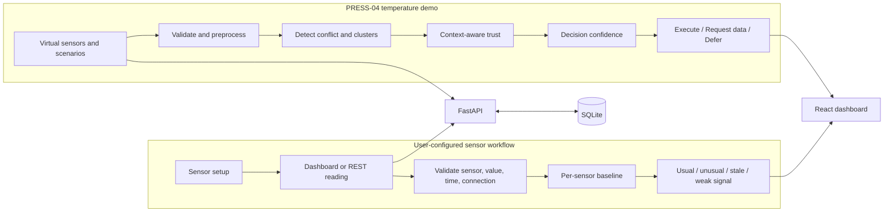
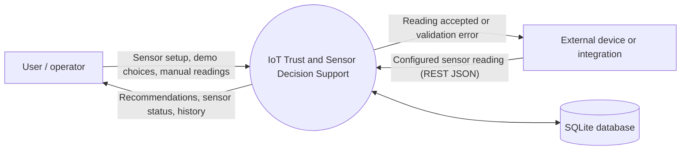
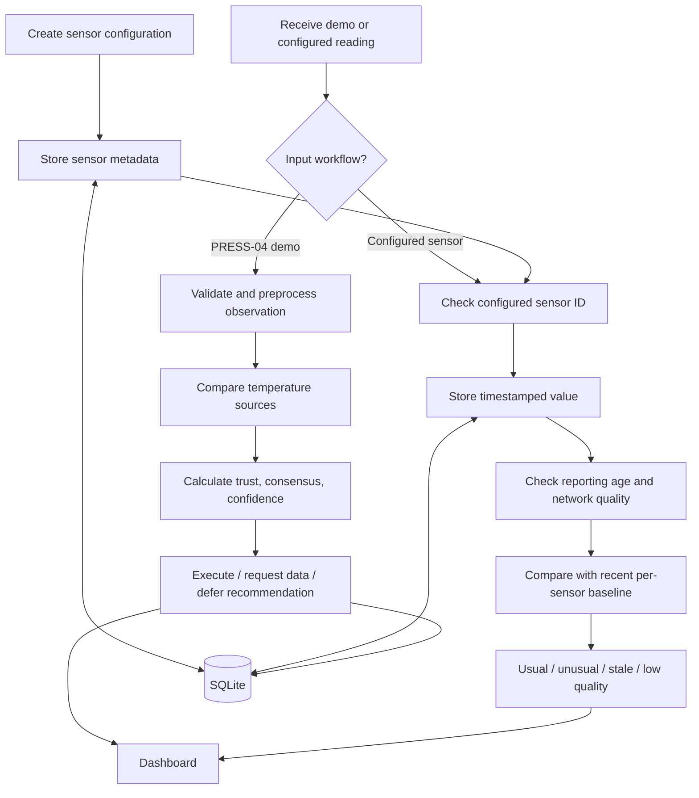
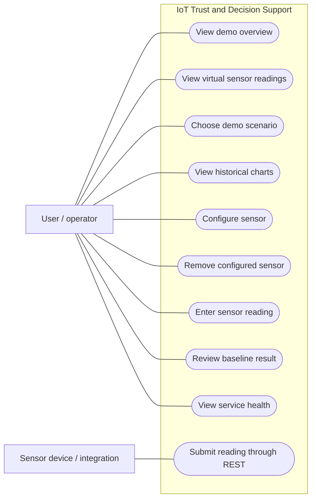
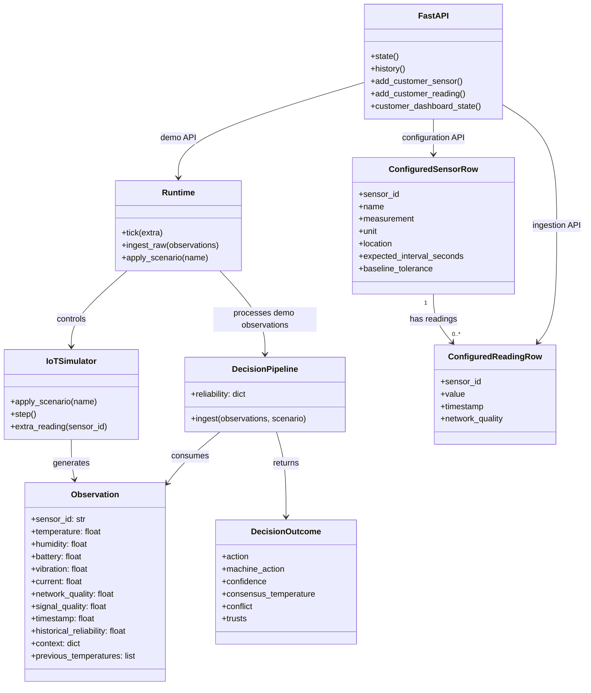
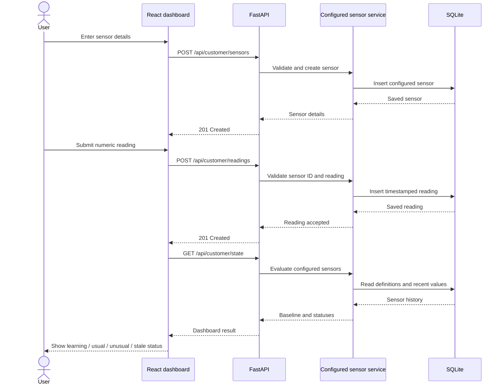

# CONTEXT-AWARE TRUST AND SENSOR DECISION SUPPORT FOR IOT SYSTEMS

## PROJECT REPORT

**Submitted by:** [Student Name]<br>
**Register number:** [Register Number]<br>
**Department:** [Department Name]<br>
**Institution:** [Institution Name]<br>
**Project guide:** [Guide Name]<br>
**Academic year:** [Academic Year]

> **Formatting note:** This is the editable report draft. Page numbers in the
> contents are marked **TBD** because pagination depends on the institution's
> required font, spacing, margins, title page, and exported format. Update them
> after applying the final Word/PDF layout. The supplied format repeats section
> number 3.2.2 for Social Feasibility; this report numbers it 3.2.3.

---

## CONTENTS

| Sl. No. | Contents | Page No. |
|---:|---|:---:|
|  | **Abstract** | i |
| 1. | **INTRODUCTION** | TBD |
| 1.1 | Background | TBD |
| 1.2 | Motivation | TBD |
| 1.3 | Scope of the Project | TBD |
| 2. | **PROJECT DESCRIPTION AND GOALS** | TBD |
| 2.1 | Literature Review | TBD |
| 2.2 | Research Gap | TBD |
| 2.3 | Objectives | TBD |
| 2.4 | Problem Statement | TBD |
| 2.5 | Project Plan | TBD |
| 3. | **TECHNICAL SPECIFICATION** | TBD |
| 3.1 | Requirements | TBD |
| 3.1.1 | Functional Requirements | TBD |
| 3.1.2 | Non-Functional Requirements | TBD |
| 3.2 | Feasibility Study | TBD |
| 3.2.1 | Technical Feasibility | TBD |
| 3.2.2 | Economic Feasibility | TBD |
| 3.2.3 | Social Feasibility | TBD |
| 3.3 | System Specification | TBD |
| 3.3.1 | Hardware Specification | TBD |
| 3.3.2 | Software Specification | TBD |
| 4. | **DESIGN APPROACH AND DETAILS** | TBD |
| 4.1 | System Architecture | TBD |
| 4.2 | Design | TBD |
| 4.2.1 | Data Flow Diagram | TBD |
| 4.2.2 | Use Case Diagram | TBD |
| 4.2.3 | Class Diagram | TBD |
| 4.2.4 | Sequence Diagram | TBD |
| 5. | **METHODOLOGY AND TESTING** | TBD |
| 5.1 | Module Description | TBD |
| 5.2 | Testing | TBD |
| 6. | **PROJECT DEMONSTRATION** | TBD |
| 7. | **RESULT AND DISCUSSION (COST ANALYSIS)** | TBD |
| 8. | **CONCLUSION** | TBD |
| 9. | **REFERENCES** | TBD |

---

## **ABSTRACT**

Internet of Things (IoT) applications receive measurements from sensors that
may differ in accuracy, age, communication quality, and operating conditions.
When readings disagree, a simple threshold or arithmetic average can lead to a
misleading result. This project develops a software prototype for examining
sensor evidence before presenting a decision recommendation.

The prototype has two distinct workflows. The first is a simulated industrial
temperature-monitoring demonstration. Four virtual sensors provide temperature
observations and contextual information. A processing pipeline validates and
preprocesses observations, detects disagreements, estimates source trust using
historical reliability and current evidence, calculates confidence, and
selects one of three decision responses: execute a machine intent, request
additional data, or defer for review. The machine intents are normal, warning,
shutdown, and hold. This workflow is designed to demonstrate trust-aware
decision logic; it does not actuate real machinery.

The second workflow allows a user to configure sensors with a sensor identifier,
measurement name, unit, location, and expected reporting interval. Readings
can be entered through the dashboard or submitted to a REST API. The system
learns a per-sensor baseline from the initial five readings and compares
subsequent readings with recent history using a median and median absolute
deviation-based spread. It labels data as learning, usual, unusual, stale, or
low quality. Different sensor measurements are evaluated independently and
are not combined into a cross-measurement machine decision.

The application uses Python, FastAPI, Pydantic, SQLAlchemy, and SQLite for the
backend, and React, TypeScript, Vite, Tailwind CSS, and Recharts for the
dashboard. Automated tests cover the decision scenarios, decision bands,
configurable sensor baseline behavior, stale data, invalid sensor submissions,
and a database schema update. The implementation is a local, single-workspace
prototype. It has no customer authentication, tenant isolation, physical
hardware connector, or safety certification. Results should therefore be
treated as decision support for demonstration and evaluation, not as a
safety-critical control system.

**Keywords:** Internet of Things, sensor trust, conflicting readings, data
freshness, anomaly detection, baseline, decision confidence, FastAPI, React.

---

# 1. **INTRODUCTION**

## 1.1 Background

An IoT system connects physical devices, sensors, communication networks, and
software services. Sensors convert physical conditions—such as temperature,
humidity, vibration, speed, or current—into readings that software can store
and analyze. These readings can support monitoring, maintenance, and
operational decisions.

A sensor reading is evidence, not guaranteed truth. A sensor may be
miscalibrated, damaged, disconnected, delayed, or affected by its location.
Two sensors observing the same condition may therefore report different
values. The software must decide how to handle this disagreement.

For example, suppose three temperature sensors report 75°C, 73°C, and 30°C.
Shutting down based on any single reading could cause an unnecessary
interruption if that reading is faulty. Averaging all three produces 59.3°C,
which could hide a genuine high-temperature condition. A more cautious system
checks which readings are recent, consistent with sensor history, supported by
other sources, and communicated over an acceptable network.

This project demonstrates two ways to handle sensor evidence:

1. A **multi-source temperature trust pipeline** that compares several
   simulated sensors and selects an action based on trust mass and confidence.
2. A **user-configured per-sensor baseline pipeline** that learns each
   configured sensor's usual range and flags unusual or stale readings.

These workflows are intentionally separate. The configurable workflow accepts
arbitrary measurement names and units, but currently analyzes each sensor
against its own historical values. It does not yet combine different sensors
into one generic decision model.

## 1.2 Motivation

The project is motivated by the following issues:

- A fixed threshold does not account for a sensor being old or poorly
  connected.
- A plain average gives unreliable sensors the same influence as reliable
  sensors.
- A single faulty reading can disagree sharply with otherwise consistent
  sources.
- An even split between sources cannot safely be resolved by majority vote
  alone.
- Users need a simple dashboard that communicates the result without requiring
  them to interpret raw algorithm scores.
- A reusable software prototype should allow users to describe their own
  sensors and submit readings without requiring physical hardware during
  development or evaluation.

The project aims to make the reasoning visible: show the source readings,
highlight evidence quality, and state whether the system recommends action,
additional information, or review.

## 1.3 Scope of the Project

### Included in the current prototype

- A virtual industrial machine and four simulated temperature sensors.
- Six simulator scenarios: normal operation, one faulty sensor, split
  conflict, poor network, stale reading, and emergency.
- Temperature preprocessing, freshness and communication scoring, temporal
  consistency, source agreement, contextual relevance, conflict clustering,
  trust-mass selection, confidence calculation, and a three-way decision
  controller.
- A React dashboard with separate pages for overview, demo sensor readings,
  scenarios, trends, sensor setup, and configured readings.
- REST endpoints for simulator state, scenarios, sensor configuration, and
  configured reading ingestion.
- SQLite persistence for configured sensor definitions and readings, as well
  as simulator readings and decisions.
- A per-sensor baseline demonstration for arbitrary measurement labels and
  units.
- Automated backend tests for key intended behaviors.

### Not included in the current prototype

- Physical sensors, ESP32 firmware, gateway software, MQTT, or a deployed
  device-to-cloud ingestion connector.
- Cross-sensor decision fusion for arbitrary user-configured measurement types.
- Unit conversion or validation that a particular unit is appropriate for a
  measurement.
- User accounts, roles, organization management, or separation of customer
  data.
- A production deployment, security assessment, load test, or safety
  certification.
- Automatic control of real equipment.

# 2. **PROJECT DESCRIPTION AND GOALS**

The system is a local web application with a Python API and React dashboard.
It demonstrates trust-aware temperature decisions using virtual observations,
and also offers a separate workflow to configure a sensor, submit readings,
and compare them against that sensor's learned baseline.

The project's main goal is not to label a sensor permanently as “good” or
“bad.” In the temperature demonstration, trust is recalculated for each
observation from historical reliability and current context. In the
configurable workflow, a reading is assessed against recent history and
communication quality.

## 2.1 Literature Review

### IoT systems and heterogeneous devices

Atzori, Iera, and Morabito survey the Internet of Things as an ecosystem of
connected objects, technologies, and applications [1]. Their work provides
background for the project’s use of sensing, communication, and software
services as connected parts of an IoT application. The present prototype
implements only a software representation of the sensor and application
layers; it does not connect physical devices.

NIST Special Publication 800-183 describes a “Network of Things” through
system primitives and discusses sensing, computing, communication, and
actuation, as well as heterogeneity and reliability/security trade-offs [2].
This supports treating an IoT reading as information produced within a system
context rather than as an isolated number. In this prototype, the
PRESS-04 workflow includes context such as operating mode, sensor location,
signal quality, and timestamp.

### Trust and reputation in sensor networks

Khalid et al. survey trust and reputation systems for wireless sensor
networks [3]. This literature discusses trust as a way to reason about
node behavior and the quality of information in settings where devices and
network links may be unreliable. The project uses this general motivation in
its temperature pipeline: historical reliability is considered alongside
current temporal behavior, peer agreement, freshness, communication, and
context.

### Robust measures for unusual observations

The configured-sensor workflow estimates a baseline using the median and
median absolute deviation (MAD). Robust statistical measures are useful when
the data may contain outliers because the median is less influenced by an
extreme value than the arithmetic mean. Rousseeuw and Croux discuss robust
alternatives to MAD and the role of robust scale estimators [4]. The
implementation uses a MAD-based scale calculation as a pragmatic prototype
choice; it is not a complete statistical calibration study.

### Web application technologies

The project uses FastAPI to expose Python functions as HTTP endpoints and
generate API documentation [5]. React provides component-based dashboard
pages [6]. SQLAlchemy maps application entities to database tables [7], and
SQLite stores the local prototype data in a file-based database [8].

### Summary of the review

The reviewed work supports three broad ideas used by the project: IoT systems
contain heterogeneous devices and networks; trust can help reason about
changing node or data quality; and robust statistics can reduce sensitivity to
extreme observations. The project combines these ideas in a demonstrator, but
does not claim that the specific weighting formula or thresholds are a
validated or novel scientific result.

## 2.2 Research Gap

The problem addressed in this project is the gap between receiving sensor
values and making a cautious, understandable software recommendation when
evidence is uncertain or inconsistent.

Many introductory monitoring examples show a direct threshold or a combined
average. For the scenarios in this project, those methods do not express
whether observations are stale, have poor communication quality, contradict
their own recent history, or form multiple competing groups. The project
therefore demonstrates a pipeline that explicitly calculates trust,
conflict, and confidence before selecting a response.

For configurable sensors, the current prototype addresses a narrower gap:
users can store their own sensor metadata and receive per-sensor baseline
checks without embedding a measurement-specific fixed threshold in the
front-end. This is not yet a general multi-sensor fusion solution. Each
configured sensor is assessed independently, and the software does not
combine temperature, vibration, humidity, or other quantities into a single
machine-level risk score.

This is a project-level design motivation, not a claim that no existing
research or product addresses these problems.

## 2.3 Objectives

1. Build a software-based IoT simulation that runs without physical sensors.
2. Generate multiple virtual temperature observations with timestamps,
   history, communication quality, reliability, and operating context.
3. Detect disagreement and group comparable temperature readings.
4. Estimate trust dynamically using source history and current observation
   quality.
5. Produce a confidence score and choose **EXECUTE**, **REQUEST_DATA**, or
   **DEFER** for the temperature demonstration.
6. Allow users to configure sensors with their own measurement names and
   units.
7. Accept configured readings from the dashboard or a REST endpoint.
8. Learn an individual sensor baseline and flag unusual, stale, or
   low-quality readings.
9. Present sensor status and recommendations through separate, understandable
   dashboard pages.
10. Verify important behaviors using automated backend tests and a frontend
    production build.

## 2.4 Problem Statement

Given a set of sensor observations for the same physical quantity, the system
must determine whether the observations are usable, whether they disagree, and
which group of observations has the stronger supporting evidence. It must
then communicate a recommendation that reflects the quality and certainty of
the evidence rather than blindly following a single reading or averaging all
readings.

Separately, for a user-configured sensor with a numeric measurement and unit,
the system must store the reading, learn the sensor's normal range from
initial data, and identify whether a new reading is usual, unusual, stale, or
received over a weak connection.

The prototype must clearly distinguish these decisions: the configurable
sensor baseline is not the same algorithm as the PRESS-04 cross-source trust
engine.

## 2.5 Project Plan

| Phase | Planned work | Current status |
|---|---|---|
| 1 | Define the IoT decision problem and software scope | Completed |
| 2 | Create virtual sensor profiles and fault scenarios | Completed |
| 3 | Validate and preprocess temperature observations | Completed |
| 4 | Detect conflicts and form temperature clusters | Completed |
| 5 | Calculate context-aware trust and confidence | Completed |
| 6 | Select execute, request-data, or defer response | Completed |
| 7 | Add FastAPI endpoints and SQLite persistence | Completed |
| 8 | Build dashboard pages and charts | Completed |
| 9 | Add user-configured sensor metadata and REST ingestion | Completed |
| 10 | Add per-sensor baseline checking and stale-data status | Completed |
| 11 | Test backend behaviors and build frontend | Completed |
| 12 | Add real device connectivity, user accounts, tenant isolation, and
  deployment hardening | Future work |

# 3. **TECHNICAL SPECIFICATION**

## 3.1 Requirements

### 3.1.1 Functional Requirements

| ID | Requirement |
|---|---|
| FR-01 | The system shall generate virtual sensor readings for the PRESS-04 demo. |
| FR-02 | The system shall provide named simulator scenarios that inject faults or conflicting readings. |
| FR-03 | The system shall validate and preprocess temperature observations, including age and communication data. |
| FR-04 | The temperature engine shall compare valid readings, detect conflicts, and group readings by temperature similarity. |
| FR-05 | The temperature engine shall calculate trust scores from historical and current evidence. |
| FR-06 | The controller shall select execute, request additional data, or defer based on decision confidence. |
| FR-07 | The REST API shall provide simulator state, history, scenario selection, and raw temperature-observation ingestion. |
| FR-08 | A user shall be able to add a sensor definition with ID, name, measurement, unit, location, and reporting interval. |
| FR-09 | The API shall reject duplicate configured sensor IDs and readings for unknown sensor IDs. |
| FR-10 | A user or external client shall be able to submit a configured sensor reading and optional network quality and timestamp. |
| FR-11 | The configured-sensor workflow shall learn a baseline, detect unusual changes, and distinguish stale or poor-quality readings. |
| FR-12 | The dashboard shall show the PRESS-04 demo and the configurable-sensor workflow on separate pages. |
| FR-13 | The system shall persist configured sensor definitions and readings in SQLite. |
| FR-14 | Removing a configured sensor shall also remove its associated saved readings. |

### 3.1.2 Non-Functional Requirements

| ID | Requirement |
|---|---|
| NFR-01 | The application shall run on a developer computer without physical IoT hardware. |
| NFR-02 | The REST API shall use JSON request and response bodies. |
| NFR-03 | The sensor setup form shall validate required fields before submission. |
| NFR-04 | The backend shall return explicit HTTP errors for invalid or unknown sensor submissions. |
| NFR-05 | The dashboard shall use clear labels and separate tasks into navigable pages. |
| NFR-06 | Database initialization shall create missing tables and upgrade the configured-sensor table when required. |
| NFR-07 | Backend decision behavior shall be covered by repeatable automated tests. |
| NFR-08 | Results shall be described as prototype recommendations and not as certified safety controls. |
| NFR-09 | The current local application shall not be treated as a multi-customer hosted system because authentication and tenant isolation are absent. |

## 3.2 Feasibility Study

### 3.2.1 Technical Feasibility

The prototype is technically feasible using common web-development tools.
Python implements the API and decision logic. FastAPI exposes endpoints and
uses Pydantic models for request validation. SQLAlchemy and SQLite provide
local persistence. React and TypeScript implement the dashboard, while
Recharts renders demo history charts.

The project's algorithmic tasks—simulator generation, pairwise temperature
comparison, robust per-sensor baseline calculation, and status display—are
small enough for a local software demonstration. The application has been
verified through automated tests and a production frontend build.

The current implementation does not establish deployment readiness. It has
not been evaluated for concurrent customer use, high-throughput ingestion,
security hardening, or real equipment safety. Real-device integrations and
tenant isolation would require additional architecture and testing.

### 3.2.2 Economic Feasibility

The local demonstration does not require the purchase of sensors, an
ESP32, a broker, or a cloud account. The application uses a local SQLite file
and software packages listed in the repository. This makes an academic
prototype inexpensive to run on an existing development computer.

This report does not assign a commercial hosting cost or total product
development cost. Those figures depend on deployment provider, traffic,
retention, support, security requirements, device count, and applicable
software licenses. A commercial service would also require investment in
authentication, customer isolation, monitoring, backups, operational support,
and security review.

| Cost category | Current prototype |
|---|---|
| Physical sensors | Not required |
| Local database | SQLite file; no separate database server |
| Backend/frontend runtime | Existing computer and installed software |
| Cloud hosting | Not included or priced |
| Commercial operations | Not included or priced |

### 3.2.3 Social Feasibility

The intended benefit is to help operators or evaluators notice when readings
may be unreliable and understand why the software recommends requesting more
information or human review. Presenting a clear status and explanation may
support better-informed decisions than displaying raw numbers alone.

The system must not encourage users to treat a calculated score as certainty.
Incorrect baselines, poor sensor installation, biased data, or misunderstood
units may lead to incorrect flags. The interface and deployment process should
retain human oversight, clearly distinguish simulated from real measurements,
and never imply that the prototype is a certified safety system.

## 3.3 System Specification

### 3.3.1 Hardware Specification

**Prototype execution hardware**

- A personal computer or laptop capable of running a supported Python
  interpreter, Node.js, and a modern web browser.
- Network access to localhost so the frontend can call the local API.
- Disk space for the source code, dependencies, and SQLite data file.

**Physical IoT hardware**

- No physical sensors, microcontroller, gateway, or actuator is needed for
  this prototype.
- A future deployment may connect physical devices through REST or another
  transport, but that connector is outside the current implementation.

The repository does not define or benchmark a minimum CPU, memory, or disk
capacity; exact hardware requirements should be measured if the software is
packaged for deployment.

### 3.3.2 Software Specification

| Layer | Software / technology | Use |
|---|---|---|
| Backend language | Python | Simulator, validation, trust logic, baseline checks |
| API framework | FastAPI | REST endpoints and API documentation |
| Validation | Pydantic | Typed request and observation models |
| ORM | SQLAlchemy | Database models and queries |
| Database | SQLite | Local reading, decision, sensor, and history storage |
| Frontend | React + TypeScript | Dashboard pages and interaction |
| Development/build | Vite | Frontend dev server and production bundle |
| Styling | Tailwind CSS | Dashboard layout and styles |
| Charts | Recharts | Temperature and confidence history |
| Testing | pytest | Backend unit and behavior tests |

Version constraints for backend packages are listed in
[backend/requirements.txt](../backend/requirements.txt). Frontend dependencies
and the lockfile are in [frontend/package.json](../frontend/package.json) and
[frontend/package-lock.json](../frontend/package-lock.json).

# 4. **DESIGN APPROACH AND DETAILS**

## 4.1 System Architecture

The system contains two logical processing paths that share the API, database,
and dashboard:

1. **PRESS-04 demo path:** virtual temperature sensors → preprocessing →
   conflict detection → context-aware trust → confidence → decision response.
2. **Configured sensor path:** user/device reading → sensor lookup and
   validation → per-sensor recent-history baseline → reading status →
   configured-sensor dashboard.



The simulator operates on its own PRESS-04 cycle. Configured sensors store
their own definitions and readings. A configured sensor's “unusual” state is
not a command to shut down equipment.

## 4.2 Design

The backend is divided into the simulator, temperature decision engine,
configured-sensor service, API routes, persistence models, and database
initialization. The frontend separates the demo pages from user-configured
sensor setup and readings. The main UI navigation keeps these work areas
distinct.

### 4.2.1 Data Flow Diagram

#### Level 0: Context diagram



#### Level 1: Main processing



### 4.2.2 Use Case Diagram



### 4.2.3 Class Diagram



### 4.2.4 Sequence Diagram



# 5. **METHODOLOGY AND TESTING**

## 5.1 Module Description

### 5.1.1 Virtual sensor simulator

The simulator contains four sensor profiles named S01 through S04. It
generates observations around a simulated machine temperature and adds
small random variation. Sensor profiles contain locations, roles, reliability,
history, and measurement noise. Scenario selection can inject a spike, a
stuck-low reading, an old timestamp, or poor network/signal quality.

The simulated “true temperature” is available for demonstration but is not
used by the trust engine to make its decision.

### 5.1.2 Temperature preprocessing

For each observation, preprocessing checks whether the temperature is finite
and within the configured physical range of −20°C to 200°C. It calculates
freshness as:

```text
freshness = exp(−max(0, age_seconds) / freshness_tau_seconds)
```

The configured freshness time constant is 25 seconds. Observations at least
40 seconds old are marked stale in their notes. Communication quality is
calculated as the square root of network quality multiplied by signal quality,
with the inputs bounded to the range 0 to 1.

### 5.1.3 Conflict detection and clustering

The temperature demo compares every pair of valid observations. A pair is
marked as a conflict when the temperature gap is at least 8°C. Pair agreement
uses exponential decay with a 4°C scale. Readings are sorted by temperature
and grouped when adjacent readings are less than the conflict gap apart.
Conflict level is reported as low, medium, or high based on the conflict
fraction and cluster pattern.

### 5.1.4 Context-aware trust calculation

For valid temperature observations, the implementation calculates:

- **Temporal consistency:** whether the reading is near the sensor's prior
  readings and whether the new value jumps sharply.
- **Source agreement:** average pairwise similarity to the other valid
  temperature observations.
- **Freshness:** age-based evidence quality.
- **Communication quality:** a combined network and signal score.
- **Contextual relevance:** adjustments for sensor role, location, machine
  mode, battery state, and observation age.
- **Historical reliability:** prior reliability that is adjusted over
  successive sufficiently confident decisions.

The current engine uses the following implementation pattern. It is an
engineering heuristic, not a statistically calibrated probability:

```text
evidence_quality = freshness^1.15 × communication_quality^1.05
prior_weight = 0.55 × (1 − evidence_quality) + 0.22
live_evidence = 0.55 × temporal_consistency + 0.45 × source_agreement
posterior_score = prior_weight × historical_reliability
               + (1 − prior_weight) × live_evidence
trust_score = evidence_quality × posterior_score
            × (0.35 + 0.65 × contextual_relevance)
```

Scores are bounded and classified as trusted, uncertain, or low trust.
Invalid observations receive a trust score of zero.

### 5.1.5 Confidence and decision controller

Trust is added within each conflict cluster. The cluster with the greatest
trust mass is selected as the dominant group. Its temperature is combined
using trust-weighted values. Confidence then considers dominant trust mass,
within-cluster agreement, evidence quality, temperature-decision clarity, and
a penalty when a competing cluster also has substantial trust.

Decision thresholds in the current prototype are:

| Confidence | Response |
|---:|---|
| At least 0.80 | Execute the machine intent in the simulation |
| 0.50 to below 0.80 | Request more sensor data; hold machine intent |
| Below 0.50 | Defer and request additional information or human review |

The machine intent is determined from the trust-weighted temperature
consensus: below 70°C is normal, at least 70°C is warning, and at least 78°C
is shutdown. These are demonstration thresholds in configuration, not
industrial operating limits.

### 5.1.6 Configured sensor and baseline service

Users can create a configured sensor with a unique ID, name, measurement,
unit, location, expected reporting interval, and optional baseline tolerance.
Sensor definitions and timestamped readings are stored separately from
PRESS-04 demo data.

The first five readings are used to build a starting history. Beginning with
the sixth reading, the latest reading is compared with previous readings from
the same sensor, up to a 30-reading window. The baseline centre is the median.
The robust scale is calculated as:

```text
spread = 1.4826 × median(abs(previous_value − baseline_median))
deviation_score = abs(latest_value − baseline_median) / spread
```

If the calculated spread is effectively zero, the optional sensor tolerance
is used; otherwise, a small fallback spread based on the median is applied.
A deviation score of at least 3.5 is marked unusual. The dashboard can also
show learning, no data, stale data, and low connection quality.

Freshness is reduced with the expected reporting interval. Readings older than
three expected intervals are marked stale. A reported network quality below
0.3 is flagged as weak. These thresholds are initial prototype settings and
must be validated against the actual sensor, units, and use case before
operational use.

### 5.1.7 API and persistence

FastAPI exposes endpoints for simulator state, scenarios, history, sensor
configuration, configured readings, and configured sensor results. Pydantic
schemas validate input ranges and required fields. SQLAlchemy models map
readings, decisions, configured sensors, and configured readings to SQLite
tables.

The database initialization creates tables and applies a small migration for
the reporting-interval column on existing configured sensor databases.

### 5.1.8 Dashboard

The React dashboard separates the tasks into Overview, Sensor readings, Try a
scenario, History & trends, Sensor setup, and My readings. It shows the
recommendation and simplified statuses while keeping algorithm details in
separate areas. The UI is a demonstration interface and is not an alarm panel
for real machinery.

## 5.2 Testing

### Test approach

Backend tests use controlled observations, a temporary SQLite database, and
assertions on outcomes. They check both expected status and important decision
properties. Frontend validation uses the TypeScript production build and
Oxlint.

### Tested behaviors

| Test group | Behavior verified |
|---|---|
| PRESS-04 normal | Similar readings produce low conflict and normal operation |
| PRESS-04 faulty sensor | One high outlier is downweighted and does not dominate the consensus |
| PRESS-04 split conflict | Trust mass selects the stronger faction rather than headcount alone |
| PRESS-04 poor network | A stale high reading with weak communication does not blindly trigger shutdown |
| PRESS-04 stale reading | Stale evidence has lower freshness and trust |
| PRESS-04 emergency | Fresh, agreeing high readings support a shutdown recommendation |
| Decision bands | Medium confidence requests data; low confidence defers and holds actuation |
| Configured sensor baseline | Initial readings remain in learning/calibration state |
| Configured sensor anomaly | A value far from its baseline is marked unusual |
| Configured sensor data quality | Old readings are marked stale; unknown IDs are rejected |
| Sensor management | Removing a sensor removes its associated readings |
| Database migration | An older SQLite schema gains the reporting interval column |

### Verification results

At the time this report was prepared:

- Backend automated test suite: **15 passed**.
- Frontend production build and TypeScript check: **passed**.
- Frontend lint command: completed with React initial-load effect warnings.
- Production build emitted a bundle-size warning because the generated
  JavaScript chunk exceeds Vite's default 500 kB warning threshold.

These are software verification results only. They do not demonstrate
statistical accuracy on real sensor data, real-time performance at production
scale, or suitability for safety-critical use.

# 6. **PROJECT DEMONSTRATION**

## 6.1 Demonstration environment

The application runs locally in a browser with the FastAPI backend and Vite
frontend. The simulator runs virtual sensors; no physical device is necessary.

## 6.2 PRESS-04 demo steps

1. Start the backend and frontend using the commands in the README.
2. Open the dashboard and select **Try a scenario**.
3. Select **Normal readings** and observe the temperature recommendation.
4. Select **One faulty sensor** and compare sensor readings, trust, and the
   recommendation.
5. Select **Sensors disagree** to demonstrate that the system considers
   source trust rather than only the number of sensors in each group.
6. Select **Weak connection** or **Old reading** to show how observation
   quality changes its influence.
7. Select **Very high temperature** to show the high-trust emergency
   recommendation.
8. Open **History & trends** to view changes across simulator cycles.

## 6.3 Configured sensor steps

1. Open **Sensor setup**.
2. Add a sensor. Example: ID `motor-vibration-1`, measurement `vibration`,
   unit `mm/s`, and an expected reporting interval.
3. Open **My readings** and select that sensor.
4. Enter five normal readings. The result should remain in the learning state.
5. Submit a sixth reading to begin comparison with the previous baseline.
6. Submit a value far from the normal readings to demonstrate an unusual
   result.
7. Submit a reading with a timestamp older than three reporting intervals, or
   a weak network quality, to show the corresponding data-quality status.

## 6.4 Explanation for a project presentation

> “This project demonstrates two related sensor-analysis workflows. In the
> PRESS-04 simulation, four virtual temperature sensors may disagree. The
> system checks each reading's history, freshness, communication quality,
> agreement with other sources, and context before estimating confidence and
> recommending whether to act, request more readings, or defer. In the
> configurable workflow, a user defines a sensor and its unit, submits
> readings, and the software learns that sensor's normal range before
> flagging unusually different or stale values. The prototype runs without
> physical hardware and does not control real equipment.”

# 7. **RESULT AND DISCUSSION (COST ANALYSIS)**

## 7.1 Results

The completed prototype demonstrates that:

- Conflicting simulated temperature readings can be grouped and evaluated
  using source quality and context rather than only a threshold or plain
  average.
- Decision confidence can lead to three different responses: execute, request
  additional data, or defer.
- User-defined sensor labels and units can be stored without mixing values
  from unrelated sensors.
- A per-sensor baseline can be learned and used to highlight a sufficiently
  unusual later reading.
- The user-configured path can distinguish an unusual reading from a stale
  reading or weak network quality.
- The data flow and recommendation can be inspected through the REST API and
  dashboard.

The results are functional test results, not measured detection accuracy.
There is no collected real-world dataset in this prototype, so sensitivity,
specificity, false alarm rate, and missed detection rate have not been
calculated.

## 7.2 Cost Analysis

### Prototype cost

No dedicated hardware purchase is required for the software demonstration.
The project runs on a development computer using a local SQLite file. The
repository lists the Python and Node dependencies. No cloud hosting, device
cost, support cost, or commercial licensing analysis is included.

### Cost considerations for a product deployment

A commercial deployment would need a separate cost assessment covering:

- Hosting and managed database services.
- Storage, backup, retention, monitoring, and network egress.
- Sensor and gateway hardware, installation, calibration, and replacement.
- Device onboarding, authentication, encryption, and certificate management.
- Customer accounts, access roles, and data separation.
- Engineering, testing, security review, support, and regulatory requirements.
- Integration and validation for each sensor model, measurement, and unit.

No monetary total is reported because deployment assumptions and vendor prices
were not provided.

## 7.3 Discussion and Limitations

The project demonstrates an end-to-end software flow but not a market-ready
multi-customer product. Important limitations are:

1. The sophisticated multi-source trust and confidence calculation is
   specific to the PRESS-04 temperature workflow.
2. User-configured sensors have an independent, per-sensor baseline detector.
   They do not participate in multi-sensor group consensus or produce
   machine-level actions.
3. Measurement and unit are free-text labels. The service does not convert
   units or verify that readings use the expected physical quantity.
4. Five initial readings are a simple baseline warm-up, not proof that the
   readings represent normal operating conditions.
5. The MAD threshold, freshness function, network threshold, and machine
   temperature thresholds are prototype choices. They need domain calibration
   and evaluation.
6. All users share a local workspace. Authentication and tenant data
   isolation are not implemented.
7. REST is provided; MQTT and physical-device integrations are not.
8. The interface provides software recommendations only. It must not be
   connected to machinery as an automatic safety control without a separate
   engineering and certification process.

# 8. **CONCLUSION**

This project presents a software prototype for evaluating IoT sensor evidence
before displaying a recommendation. Its PRESS-04 simulation demonstrates
conflict detection, context-aware trust, trust-mass consensus, confidence
bands, and execute/request-data/defer responses. Its separate configurable
sensor workflow lets a user define a measurement and unit, submit readings,
learn a per-sensor baseline, and review unusual, stale, or low-quality data.

The prototype is runnable without physical hardware and includes a REST API,
SQLite persistence, a multi-page React dashboard, and automated tests. These
features make it suitable for academic demonstration and as a foundation for
further product development.

The next development stage should focus on validation with real, labelled
sensor datasets; measurement-specific configuration and unit controls;
multi-sensor fusion for configurable sensor groups; authentication and
customer data isolation; device onboarding and transport integration; and
security, deployment, and safety engineering. Until that work is complete,
the software should remain a non-safety-critical decision-support prototype.

# 9. **REFERENCES**

1. L. Atzori, A. Iera, and G. Morabito, “The Internet of Things: A survey,”
   *Computer Networks*, vol. 54, no. 15, pp. 2787–2805, 2010.
   [https://doi.org/10.1016/j.comnet.2010.05.010](https://doi.org/10.1016/j.comnet.2010.05.010)

2. J. Voas, *Networks of “Things”*, NIST Special Publication 800-183,
   National Institute of Standards and Technology, July 2016.
   [https://doi.org/10.6028/NIST.SP.800-183](https://doi.org/10.6028/NIST.SP.800-183)

3. O. Khalid et al., “Comparative study of trust and reputation systems for
   wireless sensor networks,” *Security and Communication Networks*, vol. 6,
   no. 6, pp. 669–688, 2013.
   [https://doi.org/10.1002/sec.597](https://doi.org/10.1002/sec.597)

4. P. J. Rousseeuw and C. Croux, “Alternatives to the Median Absolute
   Deviation,” *Journal of the American Statistical Association*, vol. 88,
   no. 424, pp. 1273–1283, 1993.
   [https://doi.org/10.1080/01621459.1993.10476408](https://doi.org/10.1080/01621459.1993.10476408)

5. FastAPI, “FastAPI Documentation.”
   [https://fastapi.tiangolo.com/](https://fastapi.tiangolo.com/)

6. Meta Open Source, “React Documentation: Learn React.”
   [https://react.dev/learn](https://react.dev/learn)

7. SQLAlchemy, “SQLAlchemy 2.0 Documentation.”
   [https://docs.sqlalchemy.org/en/20/](https://docs.sqlalchemy.org/en/20/)

8. SQLite, “SQLite Documentation.”
   [https://www.sqlite.org/docs.html](https://www.sqlite.org/docs.html)

9. Project source code and tests:
   [README](../README.md),
   [decision engine](../backend/app/engine/),
   [configured sensor service](../backend/app/configured_sensors.py),
   [backend tests](../backend/tests/),
   [invention notes](./INVENTION.md).

---

## APPENDIX A: RUNNING THE PROJECT

From the repository root, install the backend dependencies:

```bash
python3 -m venv .venv
.venv/bin/python -m pip install -r backend/requirements.txt
```

Start the backend in terminal 1:

```bash
cd backend
../.venv/bin/python -m uvicorn app.main:app --reload --port 8000
```

Start the frontend in terminal 2:

```bash
cd frontend
npm install
npm run dev
```

Open <http://localhost:5173>. The backend health endpoint is
<http://127.0.0.1:8000/api/health>, and interactive API documentation is at
<http://127.0.0.1:8000/docs>.

## APPENDIX B: TEST COMMANDS

```bash
.venv/bin/python -m pytest -q
cd frontend
npm run build
npm run lint
```
